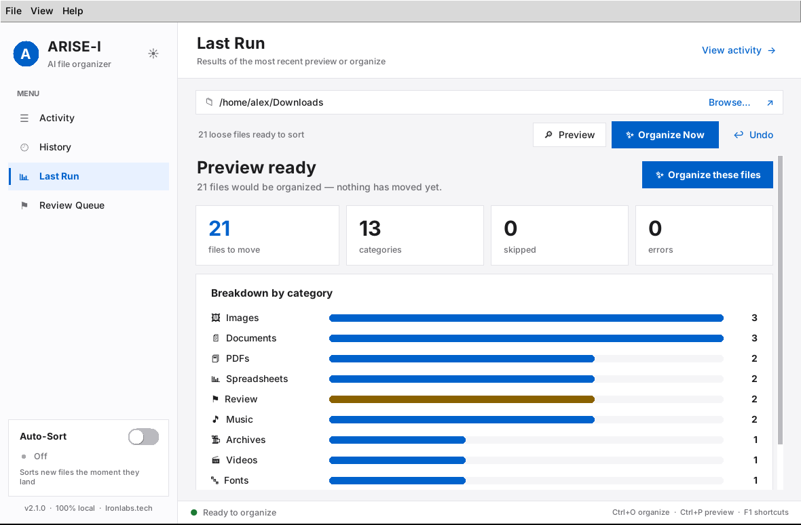
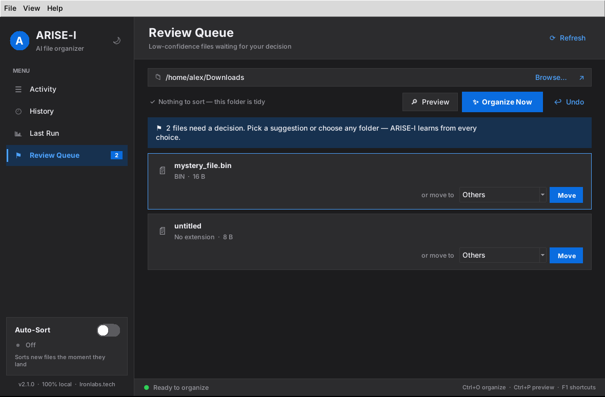

# ARISE-I

**An AI-powered file organizer that gets smarter every time you use it.**

ARISE-I watches your Downloads folder (or any folder) and automatically sorts files into neat categories — using a 4-layer AI engine that learns from your corrections. Everything runs locally; your files and data never leave your machine.

---

<p align="center">
  
  
</p>

## 🆕 What's New in v2.2.0

- **Safer runs** — overlapping runs can no longer overwrite each other's files, an interrupted run keeps its undo record, and Review decisions can be undone too
- **Smarter sorting** — fewer false matches (`blog_post` is no longer Music) and assignment copies like `Lab 2 - Bio (1).pdf` file under the right subject
- **Clearer app** — real progress counts, honest Undo results, readable colours (WCAG AA) in both themes, sharp on HiDPI screens, full keyboard focus
- **Reliable installs** — Windows installs into its own environment, release builds include the AI layer, and the code now lives in an `arise_i` package

See [CHANGELOG.md](CHANGELOG.md) for everything.

---

## ✨ Core Features

| Feature | Details |
|---|---|
| **One-Click Organization** | Click "Organize Now" — done |
| **Smart Preview** | See exactly what would move before committing |
| **Undo** | Restore the last run — or the last Review decision — any time |
| **Auto-Sort** | Watches for new files and sorts them as they arrive |
| **AI Classifier** | 4 layers: extension map → MIME sniff → filename heuristics → sklearn ML |
| **Review Queue** | Low-confidence files quarantined for manual review, not silently misfiled |
| **Self-Healing** | Background monitor repairs corrupt manifests, watches disk space, retrains on drift |
| **100 % Local** | No cloud, no API keys, no data egress — ever |

---

## 🚀 Quick Start

### Download

Grab the installer for your system from [GitHub Releases](https://github.com/arise-om/ARISE-I/releases) — Windows setup, macOS app, or Linux archive. No Python needed.

### From source

```bash
git clone https://github.com/arise-om/ARISE-I.git
cd ARISE-I
bash scripts/install.sh        # Linux / macOS  (Windows: scripts\install.bat)
scripts/start.sh               # launch          (Windows: scripts\start.bat)
```

The installer creates a private virtual environment, offers the optional AI extras (`scikit-learn` + `filetype`), and adds a desktop / app-menu shortcut.

Then: pick a folder, click **🔎 Preview** to see what would happen, and **✨ Organize Now** when you're happy. **↩ Undo** puts everything back.

### Android

Download `ARISE-I-Android.apk` from the latest release — same rules, Plan-before-move, swipeable Review queue, undo for every file, and auto-sort in the background. See [docs/ANDROID.md](docs/ANDROID.md).

The [User Guide](docs/USER_GUIDE.md) covers every screen, shortcut and option of the desktop app.

---

## 🧠 How the AI Engine Works

```
File dropped
    │
    ├── Layer 1: Extension map       → conf 0.92  (e.g. .pdf → PDFs)
    ├── Layer 2: MIME type sniff     → conf 0.88  (byte-level via filetype)
    ├── Layer 3: Filename heuristics → conf 0.76–0.88 (regex patterns)
    └── Layer 4: sklearn ML model    → trained on your corrections
               │
               ├── confidence ≥ 0.75  →  Sort to correct folder  ✅
               └── confidence < 0.75  →  __Review__/ tab          ⚠
                                              │
                                         You pick the folder
                                              │
                                         LearningStore.record()
                                              │ (every 50 events)
                                         Model retrains locally
                                              │
                                         Classifier improves 🧠
```

---

## 📂 Categories

| Category | File types |
|---|---|
| Images | `.jpg` `.png` `.gif` `.svg` `.webp` `.heic` … |
| Videos | `.mp4` `.mkv` `.avi` `.mov` `.webm` … |
| Music | `.mp3` `.flac` `.wav` `.aac` `.ogg` … |
| Documents | `.docx` `.txt` `.odt` `.rtf` … |
| PDFs | `.pdf` |
| Spreadsheets | `.xlsx` `.csv` `.ods` … |
| Presentations | `.pptx` `.odp` … |
| Code | `.py` `.js` `.ts` `.html` `.css` `.go` … |
| Archives | `.zip` `.rar` `.7z` `.tar.gz` … |
| Installers | `.exe` `.dmg` `.deb` `.apk` … |
| Ebooks | `.epub` `.mobi` |
| Fonts | `.ttf` `.otf` `.woff` … |
| Others | Everything else |
| **`__Review__/`** | Low-confidence files awaiting your decision |

**Never moved:** hidden files (`.name` or the Windows hidden/system attribute), `desktop.ini` / `Thumbs.db`, Office `~$` lock files, in-progress downloads (`.crdownload`, `.part`, `.partial`, `.download`, `.tmp`, …), and ARISE-I's own `arise-i.log`, `.arise-i-log.json` and `arise-i.config.yaml`. ARISE-I also refuses to organize a drive root or your home folder.

---

## ⚙️ CLI Usage

```bash
# Organize your Downloads folder
arise-i

# Preview without moving anything
arise-i --dry-run

# Organize a specific folder
arise-i --path ~/Desktop

# Watch a folder and auto-sort new files
arise-i --watch

# Undo the last organization
arise-i --undo
```

`python -m arise_i` is the same command. All options: `arise-i --help`.

---

## 🔌 Custom Categories

Create `arise-i.config.yaml` in the target folder (ARISE-I also checks the folder you run it from, or pass `--config path.yaml`). Extensions may omit the dot; a category may be a single string:

```yaml
Work:
  - .docx
  - .pdf
  - .xlsx

Media:
  - .mp4
  - .mkv
  - .mp3

MyScripts:
  - .py
  - .sh
```

---

## 🧩 Plugin System

Drop `.py` files into `~/.arise-i/plugins/` for custom classification logic:

```python
# ~/.arise-i/plugins/01_by_year.py
from datetime import datetime
from pathlib import Path

def classify(path: Path) -> str | None:
    if path.suffix.lower() not in {".jpg", ".jpeg", ".png"}:
        return None
    year = datetime.fromtimestamp(path.stat().st_mtime).year
    return f"Photos-{year}"
```

---

## 🛠️ Technical Details

| | |
|---|---|
| **Language** | Python 3.10+ |
| **GUI** | Tkinter (zero extra deps for base UI) |
| **Core deps** | PyYAML, watchdog |
| **AI deps** | scikit-learn, filetype *(optional)* |
| **ML model** | TF-IDF + Multinomial Naive Bayes, trained locally |
| **Storage** | `~/.arise-i/` — feedback log, model pickle, prefs |
| **Privacy** | 100 % local — no network requests, ever |
| **Platforms** | Linux, macOS, Windows, Android 8+ ([docs/ANDROID.md](docs/ANDROID.md)) |

---

## 🧪 Testing

```bash
pip install -e ".[dev,ai]"
pytest                # ~300 tests; the GUI tests need a display (xvfb-run on Linux CI)
ruff check .          # lint rules live in pyproject.toml
```

## 🗂️ Project Layout

```
arise_i/
├── core/        organizer (scan → classify → move, undo, CLI), classifier,
│                assignment parser, learning store, health monitor, watcher,
│                plugins, prefs
├── gui/         Tk app, first-run wizard, theme (palettes, fonts, animation)
└── constants.py shared file and folder names
android/         native Android app (Kotlin); its engine loads rules exported
                 from the Python classifier — see docs/ANDROID.md
packaging/       PyInstaller spec and Windows (Inno Setup) installer
scripts/         install / start scripts, demo-folder generator
tests/           pytest suite (runs against a throwaway HOME)
docs/            User Guide and screenshots
```

See [CONTRIBUTING.md](CONTRIBUTING.md) for the development workflow.

---

## 📄 License

MIT — see [LICENSE](LICENSE)

---

## 🙋 Author

**Om Deshmukh** — Robotics & Automation Engineering student, founder of [Ironlabs.tech](https://ironlabs.tech)

**Made with ❤️ by Ironlabs.tech**
